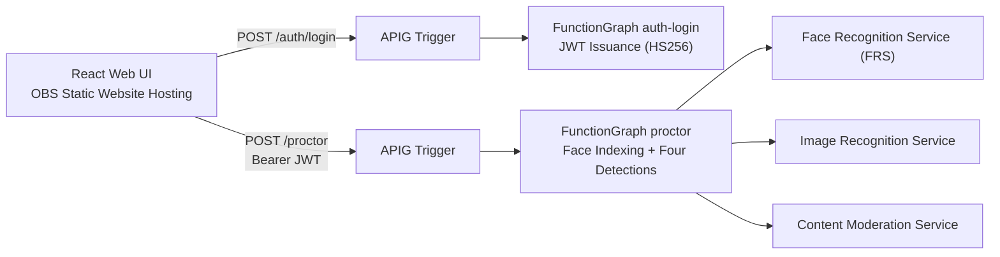

# Virtual Proctor — Online Proctoring System — Huawei Cloud Implementation


## Introduction

A **real-time proctoring web application** for online exam scenarios: after registering a candidate's face, the system periodically captures the webcam feed and performs real-time detection across four indicators — face presence, candidate identity, prohibited objects, and prohibited content — presenting the results instantly on the frontend. This repository is its **serverless** implementation on Huawei Cloud, suitable for online proctoring validation and pilot deployments by educational institutions and certification exam platforms.

## Table of Contents

- [Highlights](#highlights)
- [Cloud Services Used](#cloud-services-used)
- [Prerequisites](#prerequisites)
- [Quick Start](#quick-start)
- [Step-by-Step Deployment](#step-by-step-deployment)
- [Usage and Verification](#usage-and-verification)
- [Cleanup](#cleanup)
- [Details](#details)
- [Dependencies and Acknowledgements](#dependencies-and-acknowledgements)
- [FAQ](#faq)
- [Contributing](#contributing)
- [License](#license)
- [Contact](#contact)

## Architecture Diagram



For the full architecture and degradation notes, see [docs/architecture.md](docs/architecture.md).

## Highlights

- **Fully Serverless**: Only OBS + 2 functions + 2 triggers — no VPC, no always-on servers, resulting in near-zero fixed cost for validation scenarios.
- **Zero Third-Party Dependency in Functions**: JWT (HS256) issuance and verification are implemented using the Python standard library, so the function packages require no bundled third-party libraries.
- **Slimmed-Down Components**: Candidate name and other metadata are embedded in the face set's `external_fields`, eliminating the need for a database component; the two API endpoints are consolidated into a single `/proctor` endpoint dispatched by `action`.
- **Credential Security**: AK/SK, JWT secret, and the account table are all injected via Terraform variables (sensitive variables marked with `sensitive = true`); on the function side they are stored as KMS-encrypted environment variables — never written to disk or committed to the code repository.
- **One-Click Deployment**: Terraform describes all infrastructure; a single `terraform apply` completes the deployment.

## Cloud Services Used

| Service | Purpose |
| --- | --- |
| FunctionGraph | Login and proctoring processing |
| Object Storage Service (OBS) | Static website hosting + function code packages |
| API Gateway (Shared Edition) | Exposes functions as HTTPS endpoints via triggers |
| Face Recognition Service (FRS) | Face set, indexing, search, detection, comparison |
| Image Recognition Service | Prohibited-object label detection |
| Content Moderation Service | Prohibited-content detection |

## Prerequisites

- A real-name-verified Huawei Cloud account with the above services enabled.
- Access keys (AK/SK) with permissions for OBS, FunctionGraph, FRS, Image, and Moderation.
- Local environment: Terraform ≥ 1.3, Huawei Cloud Provider ≥ 1.97, Python 3.9+, Node.js 16+.
- Recommended region: `cn-north-4` (used as the example throughout this document).

## Quick Start

```bash
# 1. Package the two functions and upload them to OBS (see Step 2 of Step-by-Step Deployment)
# 2. Deploy the infrastructure
cd infra
export TF_VAR_web_bucket_name="<globally-unique-bucket-name>"
export TF_VAR_admin_users="admin:$(echo -n 'ChangeMe123' | shasum -a 256 | cut -d' ' -f1)"
export TF_VAR_jwt_secret="$(openssl rand -hex 32)"
export TF_VAR_auth_login_zip_url="obs://<bucket>/auth_login.zip"
export TF_VAR_proctor_zip_url="obs://<bucket>/proctor.zip"
export TF_VAR_access_key="$HW_ACCESS_KEY"
export TF_VAR_secret_key="$HW_SECRET_KEY"
terraform init && terraform apply -auto-approve

# 3. Create the face set
python ../src/setup/create_face_set.py

# 4. Build and upload the frontend
cd ../src/frontend && npm install && npm run build   # Upload build/ to the OBS bucket and write settings.js

# 5. Open the terraform output web_url in a browser, log in with admin/ChangeMe123
```

## Step-by-Step Deployment

For complete, reproducible steps (function packaging, API grouping, frontend upload, verification, and troubleshooting), see [docs/deployment-guide.md](docs/deployment-guide.md).

## Usage and Verification

1. Open the URL returned by `terraform output web_url` in a browser.
2. Log in with the account configured during deployment (default example `admin` / `ChangeMe123`).
3. Click **Add a new user**, upload the candidate's photo and fill in the name → a prompt "The user has been added." indicates successful face indexing.
4. Click **Start Virtual Proctor** and grant camera permission; the right side of the screen will display four real-time detection result cards:
   - **Face present**: exactly one face is in the frame;
   - **Person matched**: matches the registered candidate's identity (returns the name);
   - **Objects of interest**: no phones or other flagged objects detected;
   - **Content moderation**: content moderation passed.
5. Command-line verification (optional):

   ```bash
   terraform output web_url web_bucket face_set_name
   python src/samples/search_face.py src/samples/media/face-search.jpeg
   python src/samples/detect_moderation.py src/samples/media/image1.png
   ```

## Cleanup

```bash
cd infra
terraform destroy -auto-approve
```

- The face set is a standalone service resource; please delete the corresponding face set named `face_set_name` in the Face Recognition Service console.
- The OBS bucket is configured with `force_destroy = true`, so destroying it also deletes the objects inside. Confirm that no data needs to be retained.

## Details

### API Endpoints

| Method | Path | Auth | Request Body | Description |
| --- | --- | --- | --- | --- |
| POST | `/auth/login` | None | `{username, password}` | Validates the account and returns `{token, username}` (JWT, 12h) |
| POST | `/proctor` | `Authorization: Bearer <token>` | `{action:"index", image, fullName}` | Registers a candidate's face (`image` is base64) |
| POST | `/proctor` | Same as above | `{action:"process", image}` | Four real-time detections, returns `[{TestName, Success, Details}]` |

### Configuration (Terraform Variables)

| Variable | Default | Description |
| --- | --- | --- |
| `region` | `cn-north-4` | Deployment region |
| `web_bucket_name` | (required) | Frontend static bucket name, globally unique |
| `admin_users` | (required, sensitive) | `user1:sha256(password1),user2:...` |
| `jwt_secret` | (required, sensitive) | JWT signing key; recommended `openssl rand -hex 32` |
| `min_confidence` | `85` | Minimum confidence for visual detection (0-100) |
| `objects_of_interest_labels` | `Mobile Phone,Cell Phone` | Comma-separated prohibited-object labels to detect |
| `face_set_name` | `virtual-proctor-face-set` | Face set name |
| `auth_login_zip_url` / `proctor_zip_url` | (required) | OBS URL of the function code package |
| `access_key` / `secret_key` | (required, sensitive) | Keys for calling visual services, injected from environment variables |

### Security Constraint Notes

- **Credentials never persisted**: AK/SK and the account table exist only in environment variables (C8); the code repository contains no plaintext credentials.
- **Billing gate off by default**: Resource destruction requires an explicit `terraform destroy` (C9).
- **Runtime actions externalized**: Visual service calls are performed at function runtime; for production, it is recommended to replace AK/SK with delegated authorization (C10).

## Dependencies and Acknowledgements

- Runtime dependencies (all official SDKs): `huaweicloudsdkcore`, `huaweicloudsdkfrs`, `huaweicloudsdkimage`, `huaweicloudsdkmoderation`.
- Frontend dependencies: React 17, react-bootstrap, react-webcam.
- This repository is a Huawei Cloud adaptation of the online proctoring example. For the upstream project's license information and change log, see [others/license-modification-log.md](others/license-modification-log.md).

## FAQ

| Question | Resolution |
| --- | --- |
| Frontend reports a settings error | `settings.js` was not uploaded or `apiEndpoint` prefix is incorrect; see Step 8 of the deployment guide |
| Login returns 401 | The account table format must be `user:sha256(password)`, and is case-sensitive |
| Face search returns no results | First run Add User to register; or lower `min_confidence` |
| Function timeout | The trigger `timeout` defaults to 30s; for large images, increase it in the console |
| Phone not detected | Adjust `objects_of_interest_labels` or lower `min_confidence` |

## Contributing

Issues and PRs are welcome. Please read [CONTRIBUTING.md](CONTRIBUTING.md) before contributing.

## License

This repository is released under the [MIT No Attribution](LICENSE) license. Copyright © Huawei Cloud. All Rights Reserved.

## Contact

- Submitter: zhangcheng123321
