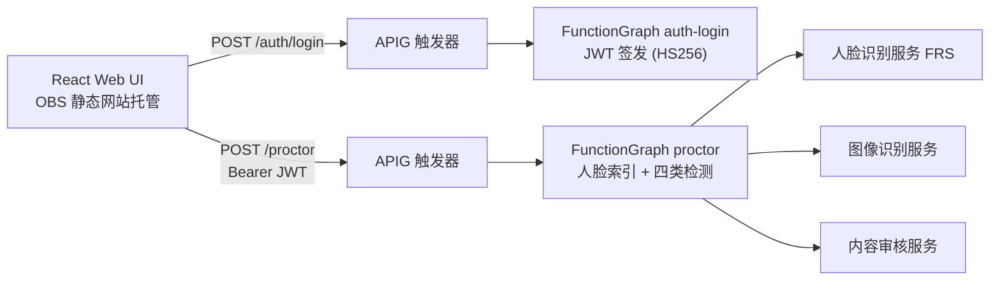

# 在线监考系统（Virtual Proctor）— 华为云实现


## 简介

面向在线考试场景的**实时监考 Web 应用**：注册考生人脸后，系统周期性截取摄像头画面，对人脸存在性、考生身份、违规物品、违规内容四类指标进行实时检测，并在前端即时呈现结果。本仓是其在华为云上的无服务器（Serverless）实现，适用于教育机构、认证考试平台的在线监考验证与试点。

## 目录

- [方案亮点](#方案亮点)
- [涉及云服务](#涉及云服务)
- [前置条件](#前置条件)
- [快速开始](#快速开始)
- [分步部署](#分步部署)
- [使用方法与验证](#使用方法与验证)
- [清理资源](#清理资源)
- [详细说明](#详细说明)
- [依赖与致谢](#依赖与致谢)
- [常见问题](#常见问题faq)
- [贡献指南](#贡献指南)
- [许可证](#许可证)
- [联系方式](#联系方式维护者)

## 架构图



完整架构与降级说明见 [docs/architecture.md](docs/architecture.md)。

## 方案亮点

- **全 Serverless**：仅 OBS + 2 个函数 + 2 个触发器，无 VPC、无常驻服务器，验证场景近乎零固定成本。
- **零第三方依赖函数**：JWT（HS256）签发与验签基于 Python 标准库实现，函数代码包无需打包任何第三方库。
- **组件瘦身**：考生姓名等元数据内嵌于人脸库 `external_fields`，免去数据库组件；两个 API 端点收敛为单一 `/proctor` 按 `action` 分发。
- **凭据安全**：AK/SK、JWT 密钥、账号表全部经 Terraform 变量注入（敏感变量 `sensitive = true`），函数侧以 KMS 加密环境变量存储，不落盘、不入代码仓。
- **一键部署**：Terraform 描述全部基础设施，`terraform apply` 一条命令完成。

## 涉及云服务

| 服务 | 用途 |
| --- | --- |
| 函数工作流 FunctionGraph | 登录与监考处理 |
| 对象存储服务 OBS | 静态网站 + 函数代码包 |
| API 网关（共享版） | 函数触发器暴露 HTTPS 接口 |
| 人脸识别服务 FRS | 人脸库、索引、检索、检测、比对 |
| 图像识别服务 | 违规物品标签识别 |
| 内容审核服务 | 违规内容检测 |

## 前置条件

- 华为云账号，已实名认证，并开通上述服务。
- 访问密钥 AK/SK（具有 OBS、FunctionGraph、FRS、Image、Moderation 相关权限）。
- 本地环境：Terraform ≥ 1.3、华为云 Provider ≥ 1.97、Python 3.9+、Node.js 16+。
- 区域建议：`cn-north-4`（本文档以该区域为例）。

## 快速开始

```bash
# 1. 打包两个函数并上传 OBS（见分步部署第 2 节）
# 2. 部署基础设施
cd infra
export TF_VAR_web_bucket_name="<全局唯一桶名>"
export TF_VAR_admin_users="admin:$(echo -n 'ChangeMe123' | shasum -a 256 | cut -d' ' -f1)"
export TF_VAR_jwt_secret="$(openssl rand -hex 32)"
export TF_VAR_auth_login_zip_url="obs://<bucket>/auth_login.zip"
export TF_VAR_proctor_zip_url="obs://<bucket>/proctor.zip"
export TF_VAR_access_key="$HW_ACCESS_KEY"
export TF_VAR_secret_key="$HW_SECRET_KEY"
terraform init && terraform apply -auto-approve

# 3. 创建人脸库
python ../src/setup/create_face_set.py

# 4. 构建并上传前端
cd ../src/frontend && npm install && npm run build   # 将 build/ 上传至 OBS 桶并写入 settings.js

# 5. 浏览器打开 terraform output web_url，用 admin/ChangeMe123 登录
```

## 分步部署

完整的可复现步骤（函数打包、API 分组、前端上传、验证与排查）见 [docs/deployment-guide.md](docs/deployment-guide.md)。

## 使用方法与验证

1. 浏览器打开 `terraform output web_url` 返回的地址。
2. 用部署时配置的账号登录（默认示例 `admin` / `ChangeMe123`）。
3. 点击 **Add a new user**，上传考生照片并填写姓名 → 提示 "The user has been added."，即人脸索引成功。
4. 点击 **Start Virtual Proctor** 并允许摄像头权限，画面右侧将实时展示四类检测结果卡片：
   - **Face present**：画面中恰有一张人脸；
   - **Person matched**：与注册考生身份一致（返回姓名）；
   - **Objects of interest**：未检测到手机等关注物品；
   - **Content moderation**：内容审核通过。
5. 命令行验证（可选）：

   ```bash
   terraform output web_url web_bucket face_set_name
   python src/samples/search_face.py src/samples/media/face-search.jpeg
   python src/samples/detect_moderation.py src/samples/media/image1.png
   ```

## 清理资源

```bash
cd infra
terraform destroy -auto-approve
```

- 人脸库为独立服务资源，请在人脸识别服务控制台删除 `face_set_name` 对应人脸库。
- OBS 桶配置了 `force_destroy = true`，销毁时连同桶内对象一并删除，请确认无需保留的数据。

## 详细说明

### API 接口

| 方法 | 路径 | 鉴权 | 请求体 | 说明 |
| --- | --- | --- | --- | --- |
| POST | `/auth/login` | 无 | `{username, password}` | 校验账号并返回 `{token, username}`（JWT，12h） |
| POST | `/proctor` | `Authorization: Bearer <token>` | `{action:"index", image, fullName}` | 注册考生人脸（`image` 为 base64） |
| POST | `/proctor` | 同上 | `{action:"process", image}` | 四类实时检测，返回 `[{TestName, Success, Details}]` |

### 配置项（Terraform 变量）

| 变量 | 默认值 | 说明 |
| --- | --- | --- |
| `region` | `cn-north-4` | 部署区域 |
| `web_bucket_name` | （必填） | 前端静态桶名，全局唯一 |
| `admin_users` | （必填，敏感） | `user1:sha256(password1),user2:...` |
| `jwt_secret` | （必填，敏感） | JWT 签名密钥，建议 `openssl rand -hex 32` |
| `min_confidence` | `85` | 视觉检测最低置信度（0-100） |
| `objects_of_interest_labels` | `Mobile Phone,Cell Phone` | 需检测的违规物品标签，逗号分隔 |
| `face_set_name` | `virtual-proctor-face-set` | 人脸库名称 |
| `auth_login_zip_url` / `proctor_zip_url` | （必填） | 函数代码包 OBS 地址 |
| `access_key` / `secret_key` | （必填，敏感） | 调用视觉服务的密钥，从环境变量注入 |

### 安全约束说明

- **凭据不落盘**：AK/SK 与账号表仅存在于环境变量（C8）；代码仓内无任何明文凭据。
- **计费门默认关闭**：资源销毁需显式执行 `terraform destroy`（C9）。
- **运行时动作外置**：视觉服务调用通过函数运行时完成，建议生产环境将 AK/SK 替换为委托授权（C10）。

## 依赖与致谢

- 运行依赖（均为官方 SDK）：`huaweicloudsdkcore`、`huaweicloudsdkfrs`、`huaweicloudsdkimage`、`huaweicloudsdkmoderation`。
- 前端依赖：React 17、react-bootstrap、react-webcam。
- 本仓为在线监考示例的华为云适配实现，上游项目许可信息与变更记录见 [others/license-modification-log.md](others/license-modification-log.md)。

## 常见问题（FAQ）

| 问题 | 处理 |
| --- | --- |
| 前端提示设置异常 | `settings.js` 未上传或 `apiEndpoint` 前缀不正确，见部署指南第 8 节 |
| 登录 401 | 账号表格式须为 `user:sha256(password)`，注意区分大小写 |
| 人脸搜索无结果 | 先执行 Add User 注册；或调低 `min_confidence` |
| 函数超时 | 触发器 `timeout` 默认 30 s，大图检测可在控制台调大 |
| 手机未被识别 | 调整 `objects_of_interest_labels` 或调低 `min_confidence` |

## 贡献指南

欢迎提交 Issue 与 PR。请阅读 [CONTRIBUTING.md](CONTRIBUTING.md) 后参与贡献。

## 许可证

本仓以 [MIT No Attribution](LICENSE) 许可发布。Copyright © Huawei Cloud. All Rights Reserved.

## 提交者

- 提交者：zhangcheng123321
