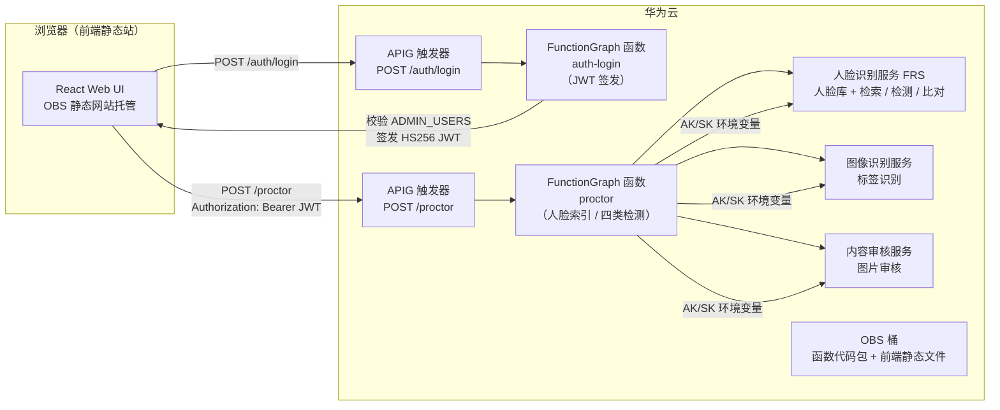

# 架构说明

## 1. 总体架构

本方案将原"在线监考"应用迁移到华为云，采用**函数即服务（FaaS）+ 对象存储**的轻量架构，无需 VPC、无需常驻计算资源：

## 2. 组件清单

| 组件 | 说明 | 数量 |
| --- | --- | --- |
| OBS 桶 | 托管前端静态网站（public-read + 网站托管 + CORS） | 1 |
| FunctionGraph 函数 `auth-login` | Python 3.9，128 MB，30 s 超时；校验账号并签发 JWT | 1 |
| FunctionGraph 函数 `proctor` | Python 3.9，256 MB，60 s 超时；人脸注册 + 四类检测 | 1 |
| APIG 触发器 | 共享版 API，HTTPS，登录与监考各一个 | 2 |
| 人脸识别服务 FRS | 人脸库（AddFaces / SearchFace / DetectFace / CompareFace） | 1 个人脸库 |
| 图像识别服务 | 图片标签识别（违规物品检测） | - |
| 内容审核服务 | 图片内容审核（违规内容检测） | - |

## 3. 认证与鉴权

- **登录**：`POST /auth/login` 提交 `{username, password}`，函数校验账号表中的 `sha256(password)`，通过后签发 **HS256 JWT**（12 小时有效），签名密钥由环境变量 `JWT_SECRET` 注入。
- **鉴权**：`POST /proctor` 必须携带 `Authorization: Bearer <token>`；函数用同一 `JWT_SECRET` 验签（`hmac.compare_digest` 防时序攻击），无效或过期返回 401。
- 账号表经环境变量 `ADMIN_USERS` 注入，格式 `user1:sha256(password1),user2:sha256(password2)`，不落盘、不进代码仓。
- 前端使用 `localStorage` 保存 token，请求统一附加 Bearer 头；收到 401 时自动登出。

## 4. 监考流程

1. **注册考生**（Add User）：前端截取照片，调用 `POST /proctor`，`action=index`；函数调用 FRS `AddFacesByBase64`，以 `external_image_id` 标识人脸、`external_fields.full_name` 内嵌姓名。
2. **实时检测**（Start Virtual Proctor）：每 300 ms 截帧，调用 `POST /proctor`，`action=process`；函数并行执行四类检测：
   - **人脸存在性**：FRS `DetectFaceByBase64`，要求画面中恰好 1 张人脸；
   - **考生身份**：FRS `SearchFaceByBase64`，按阈值匹配人脸库，返回 `external_fields.full_name`；
   - **违规物品**：图像识别 `RunImageTagging`，检查标签是否命中 `OBJECTS_OF_INTEREST_LABELS`（默认手机）；
   - **内容审核**：内容审核 `CheckImageModeration`，`suggestion != "pass"` 即违规。
3. 前端将四类检测结果（TestName/Success/Details）实时展示。

## 5. 与原架构的差异（降级说明）

| 原能力 | 迁移后 | 差异 |
| --- | --- | --- |
| 人脸索引/搜索/检测 | FRS 三接口 | 语义等价 |
| 物品识别 | 图像识别标签 | 原为标签列表含数量，现为标签存在性 |
| 内容审核 | 内容审核服务 | 语义等价 |
| 用户池托管登录 | 自建 JWT(HS256) | 无找回密码/多因素，验证场景够用 |
| 托管数据库 | FRS `external_fields` 内嵌姓名 | 免数据库组件 |
| 独立 API 端点 | 单一 `/proctor` 按 action 分发 | 端点收敛 |
| 分发网络 | OBS 静态托管直连 | 无边缘加速，中国区可绑定已备案域名 |

## 6. 安全说明

- 凭据（AK/SK、JWT_SECRET、ADMIN_USERS）全部经 Terraform 变量注入（敏感变量标记 `sensitive = true`），函数侧经 `encrypted_user_data` 以 KMS 加密存储，禁止硬编码进代码仓（C8）。
- 函数以 AK/SK 调用视觉服务；生产环境建议改为委托授权（C10 运行时动作外置）。
- 计费门默认关闭：`force_destroy` 仅在显式销毁时生效（C9）。
- 静态桶为 `public-read`，仅用于存放无敏感信息的前端构建产物；函数代码包建议放在私有桶（或部署后删除）。
